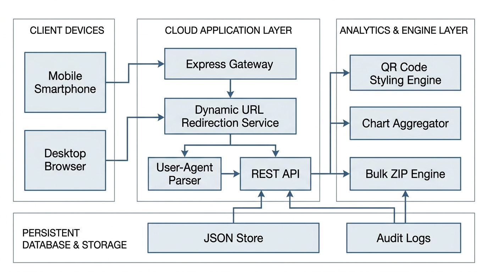

# Cloud-Based QR Code Generation and Management System

A full-stack, enterprise-grade cloud system for generating, styling, redirecting, managing, and tracking dynamic QR codes in real time.

---

## 🌟 Key Highlights & Architecture



### 1. ⚡ Dynamic Short-Link Redirection Engine (`/r/:shortCode`)
- **Zero-Reprint Updates**: Change the destination URL anytime in the cloud dashboard without reprinting or changing the physical QR code image.
- **Campaign Controls**: Toggle campaigns between **Active** and **Paused** (displays a branded maintenance / paused landing page).
- **Client Metadata Detection**: Extracts User-Agent to detect device type (Mobile, Desktop, Tablet), Operating System (iOS, Android, Windows, macOS, Linux), Browser (Safari, Chrome, Edge, Firefox), Client IP, and Referrer.

### 2. 🎨 Advanced QR Styling Studio
- **Multi-Payload Support**: Website URLs, Wi-Fi networks (SSID, password, WPA/WEP/open), Digital Business Cards (vCard), WhatsApp links, UPI Payments (`upi://pay`), Plain Text, and Email.
- **Body Dot Patterns**: Classic Square, Rounded, Circular Dots, and Classy Diamond patterns.
- **Corner Eyes (Finder Patterns)**: Custom corner square shapes (Square, Extra-Rounded, Circular) and inner corner dots.
- **Rich Dual Gradients & Colors**: Linear gradients with direction presets or solid colors, plus custom background colors.
- **Center Brand Logos**: Built-in SVG presets (Link, Wi-Fi, WhatsApp, UPI/Payment, Star) or custom image file upload.
- **Frame & CTA Badges**: "SCAN ME" bottom badge, "CONNECT WI-FI" header banner, and phone borders.
- **Multi-Format Export**: PNG (Standard 1000px, HD 2000px, Print 4000px), Vector SVG, and 1-Click Printable PDF sheet.

### 3. 📊 Real-Time Analytics & Scan Tracking
- **Interactive Visualizations (Chart.js)**:
  - Daily Scan Trajectory Timeline
  - Device Distribution Donut (Mobile vs. Desktop vs. Tablet)
  - Operating System Breakdown (iOS, Android, Windows, macOS)
  - Browser Breakdown
  - Geographic / Country Distribution
- **Live Scan Audit Stream**: Real-time table logging timestamps, short codes, devices, browsers, and IP locations.
- **Simulation Suite**: Built-in test simulation modal to simulate scans from devices worldwide and verify analytics updates instantly.
- **CSV Data Export**: One-click export of complete audit scan logs.

### 4. 📁 Cloud Campaign Manager
- Full CRUD operations with instant search and filtering by status and category.
- Inline destination editor.
- Status toggle (Active/Paused).
- Test scan launcher.

### 5. ⚡ Bulk QR Generator
- Generate dozens or hundreds of QR codes at once from lists or CSV tables.
- Downloads directly as a compressed `.zip` archive.

### 6. 📷 Integrated QR Scanner & Reader
- Live webcam video feed scanning.
- Drag-and-drop image file scanner and payload decoder.

### 7. 🔌 Developer REST API
- Interactive documentation with endpoints, cURL examples, and simulated API keys.

---

## 🚀 Quick Start Guide

### Prerequisites
- Node.js (v18 or higher)
- npm (v9 or higher)

### Installation & Run

1. Open your terminal in this project directory:
   ```bash
   npm install
   ```

2. Start the Cloud Server:
   ```bash
   npm start
   ```
   *(For auto-reload during development: `npm run dev`)*

3. Open your browser and navigate to:
   ```
   http://localhost:5000
   ```

---

## 📂 Project Structure

```
Cloud Based QR code generation and management system/
├── package.json               # Dependencies and scripts
├── server/
│   ├── app.js                 # Express server & middleware
│   ├── db.js                  # Persistent JSON-backed DB store with seed data
│   ├── routes/
│   │   ├── redirect.js        # Dynamic /r/:shortCode redirect & client detection
│   │   ├── qrcodes.js         # QR Code CRUD and rendering endpoints
│   │   ├── analytics.js       # Scan analytics, simulation, and CSV export
│   │   └── bulk.js            # Batch generation & ZIP archiver
│   └── utils/
│       └── geo.js             # User-Agent and Geo-location parser
├── public/
│   ├── index.html             # Single-Page Application interface
│   ├── css/
│   │   ├── style.css          # Design system & dark glassmorphic tokens
│   │   └── qr-studio.css      # QR Studio, cards, charts, and preview styles
│   └── js/
│       ├── app.js             # Application coordinator & toast notifications
│       ├── qr-generator.js    # Canvas styling & QR generation engine
│       ├── qr-manager.js      # Campaign manager & real-time modal editor
│       ├── analytics.js       # Chart.js analytics & live scan stream
│       ├── bulk.js            # Bulk generator and ZIP exporter
│       └── scanner.js         # Camera & image QR decoder
└── data/
    └── database.json          # Persistent database storage
```

---

## 📡 REST API Reference

| Method | Endpoint | Description |
|---|---|---|
| `GET` | `/r/:shortCode` | Dynamic QR redirect endpoint that records scan metadata |
| `GET` | `/api/qrcodes` | List all cloud QR codes with filters |
| `POST` | `/api/qrcodes` | Create a new dynamic or static QR code |
| `PUT` | `/api/qrcodes/:id` | Update target destination, title, or status |
| `DELETE` | `/api/qrcodes/:id` | Delete a QR code and its scan history |
| `GET` | `/api/qrcodes/:id/render` | Server-rendered SVG or PNG QR image |
| `GET` | `/api/analytics/overview` | Aggregated analytics, time-series, and device breakdowns |
| `GET` | `/api/analytics/export` | Download complete scan logs as CSV |
| `POST` | `/api/analytics/simulate` | Simulate a scan event for demo / testing |
| `POST` | `/api/bulk/generate-zip` | Generate batch QR codes and return ZIP file |
| `POST` | `/api/upload-logo` | Upload custom branding logo |
